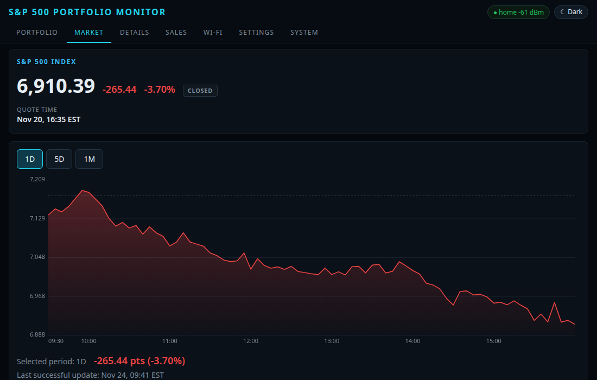
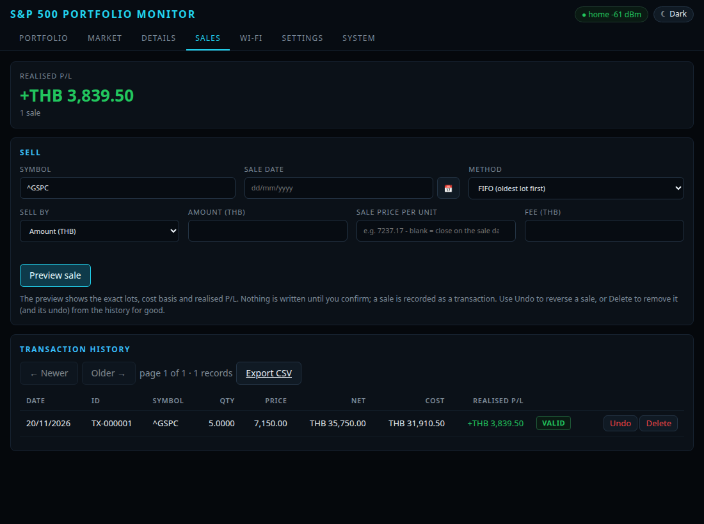

# S&P 500 Portfolio Monitor for GeekMagic SmallTV (ESP8266)

**English** | [ภาษาไทย](README.th.md)

A pocket **S&P 500 / portfolio tracker** for the GeekMagic SmallTV (ESP-12F, 240x240 LCD). It shows your portfolio value and profit/loss on the little screen and serves a full web dashboard (dark and light theme) from the same device. Quotes and charts come from Yahoo Finance; positions and the sale ledger are stored in the device's own flash. No cloud account, no server.


*The four LCD pages that rotate automatically. Rendered on the host with the real firmware font renderer from sample data; the physical panel was not photographed.*

## Screenshots

| Portfolio (dark) | Portfolio (light) |
|---|---|
|  |  |

| Market chart (1D / 5D / 1M) | Sales: sell form and transaction history |
|---|---|
|  |  |

<p align="center"></p>

*Web screenshots are taken against `tools/mock_server.py` with sample data, so numbers are illustrative.*

## Features

* **Portfolio-first LCD:** NAV, unrealised / realised / lifetime P/L in THB, invested capital, per-position rows, and a live `^GSPC` ticker. Pages and chart ranges rotate on a timer (the SmallTV has no buttons).
* **Web dashboard** at `http://sp500.local`: portfolio, interactive 1D / 5D / 1M chart, sortable position table, add and delete positions, Wi-Fi setup, settings, diagnostics, firmware upload. Dark / light theme that follows your OS.
* **Sale ledger:** sell with FIFO or a specific lot, preview before committing, undo (a reversal record), delete a transaction, CSV export. Append-only with power-loss recovery.
* **Honest numbers:** unknown data is `N/A`, never `0`; a failed refresh keeps the last value and marks it STALE; market status follows the NYSE calendar and New York DST.
* **Self-contained setup:** first boot opens a setup access point with a captive portal; a WPA2 rescue AP appears if the saved network is lost for 3 minutes.
* **OTA updates** from the web page or `pio run -t upload --upload-port <ip>`.

## How it works

```
Yahoo Finance -> MarketData (scheduler) -> AppState (raw inputs)
                                              |
                              FinancialCalculator (the only place money is computed)
                                              |
                      derived outputs: summary / results / quote / chart stats
                            |                                  |
                       SmallTV LCD                     Web API + dashboard
```

Ported from `sp500.ino` (ESP32/TFT_eSPI): same position model (`symbol, qty, buy, date`), same `/portfolio.json` format, same Yahoo `v8/finance/chart` source, same "buy date + THB amount -> buy price = that day's close, qty = THB / price" input convention. Wi-Fi/AP/OTA patterns come from `esp8266_macui.ino`; the display driver and Inter font renderer are copied from it (`src/display/font/`).

## Status - read this first

Firmware **v1.1.1**. Hardware-verified items are marked below; everything else is host-tested only.


| Area | State |
|---|---|
| Firmware builds, flashes, boots | **Verified on a real device** (USB serial, currently COM6) |
| Wi-Fi join, mDNS, NTP | **Verified on device** (joined, `sp500.local` announced) |
| Live Yahoo ^GSPC quote + 1D/5D/1M charts, TLS, memory | **Verified on device** (see *Memory*) |
| Portfolio maths | Host-tested (729 checks) **and** the on-device NAV/P&L matches an independent calculation |
| Sale ledger (sell / undo / delete / history / CSV, realised + lifetime P/L) | Host-tested (128 sale-engine checks). **Verified on device (v1.1.1):** preview, confirm (manual and Yahoo-close price), undo, delete, history and CSV, with no reset. Power-loss recovery of the ledger is **not** exercised on hardware |
| LCD layout | Rendered on the host with the real font renderer (68 frames incl. the realised page, 0 overflow/overlap). **The physical LCD was not looked at** |
| Web dashboard | Browser-tested against a mock server (desktop + 390 px mobile) **and** opened from the real device (portfolio, sales, theme toggle, sell flow) |
| OTA upload | **Verified on device** (repeated flashes with `pio run -t upload --upload-port <ip>`) |
| Rescue AP, captive portal, router-restart recovery, wrong password, settings persistence across reboot | Implemented, **not yet exercised on hardware** |
| Long-run stability (hours), heap fragmentation trend | **Not tested** (minutes only). The heap is tight: see *Memory* |

## Hardware

GeekMagic SmallTV, ESP-12F (ESP8266, 4 MB flash), ST7789 240x240 (SPI **mode 3**, backlight active-low). Pins (from the reference firmware, `src/display/font/lcd_gfx.cpp`): SCLK 14, MOSI 13, DC 0, RST 2, CS 15, BL 5. **No buttons**, so pages and chart ranges rotate automatically (`pageRotateS`).

## Build and flash

Requirements: PlatformIO (tested 6.2.0, `espressif8266@4.1.0` = Arduino-ESP8266 core 3.1.x). Libraries are fetched automatically:

| Library | Version |
|---|---|
| GFX Library for Arduino (moononournation) | 1.6.8 |
| ESP8266 core: ESP8266WiFi, ESP8266WebServer, ESP8266mDNS, DNSServer, ArduinoOTA, Updater, LittleFS | bundled with core 3.1.x |

```bash
cd SP500_SmallTV
pio run                                        # build
pio run -t upload --upload-port COM6           # flash (USB-serial, CH340; COM3 on the original bench)
python tools/serial_log.py COM6 60 --reset     # watch the boot log
```

`tools/patch_gfx_lib.py` runs automatically before the build. It stubs one unused function in the *build copy* of the GFX library to free 6.9 KB of RAM (ESP8266 keeps non-PROGMEM `const` tables in RAM). Without it the Yahoo TLS handshake leaves ~3.6 KB of heap and the chip resets.

**Arduino IDE** (untested): board *NodeMCU 1.0 (ESP-12E)*, CPU 160 MHz, Flash *4MB (FS:2MB OTA:~1019KB)*. Open `SP500_SmallTV.ino`, install the libraries above, and apply the same RAM saving by hand (delete `Arduino_DataBus::writeYCbCrPixels` from the GFX library). PlatformIO is the supported path.

## First-time setup (no Wi-Fi saved)

1. Power on. The LCD shows a QR code and **`sp500-setup-XXXXXX`** (open AP).
2. Join it from a phone (scan the QR). The captive portal opens the dashboard on the **Wi-Fi** tab (or browse to `http://192.168.4.1`).
3. Press *Scan*, pick your **2.4 GHz** network (ESP8266 cannot use 5 GHz), enter the password, *Connect*. The result is reported; credentials are saved only after a successful join.
4. Reach the dashboard at **`http://sp500.local`** or the IP shown on the System tab.

**Wi-Fi recovery.** If the saved network is unreachable for 3 minutes (router replaced, password changed, router off), the device raises a **WPA2 rescue AP** `sp500-setup-XXXXXX` with a random key shown **only on the LCD** (also inside the QR). Join it, open `http://192.168.4.1`, pick the new network. While the rescue AP is up the admin password is waived (physical presence = authorization). The device keeps retrying the saved network and shuts the AP down once it is back and stable. *Forget saved network* (Wi-Fi tab) returns to the open setup AP.

## Using it

* **LCD pages** (auto-rotating, dots show the page): 1 Portfolio (NAV, unrealised P/L THB and %, realised, lifetime, invested, positions, S&P ticker), 2 Positions (2 rows per screen, every row reachable, totals, S&P ticker), 3 Market (price, change, status, 1D -> 5D -> 1M charts, O/H/L/Prev or 1M change), 4 Realised P/L (all-time, this year, sales, reversed, last sale) - page 4 is always in the rotation (it shows 0.00 and "no sales yet" until the first sale). The `^GSPC` ticker stays on pages 1-2.
* **Choosing LCD pages:** Settings tab -> *LCD pages to show* (1 Portfolio, 2 Positions, 3 Market, 4 Realised P/L). The rotation and the header dots follow your choice at once, no reboot. At least one page must stay ticked; the Wi-Fi setup screen is always available. *Market page charts* (1D / 5D / 1M) picks which chart ranges page 3 cycles through; it changes only the LCD, the web chart still offers all three.
* **Web** `http://sp500.local`: Portfolio, Market (interactive chart, 1D/5D/1M), Details (sortable table, add/delete positions), **Sales** (realised summary, sell form with preview/confirm, transaction history with undo and CSV export), Wi-Fi, Settings, System (diagnostics, restart, resets, OTA). The date field takes **dd/mm/yyyy** with a calendar button; the API itself uses ISO `yyyy-mm-dd`.
* **Adding a position:** symbol, purchase date, THB amount. The device fetches the close on that date (last bar *on or before* it for weekends/holidays; never a later bar) and stores `qty = THB / close`. Or enter quantity + buy price directly.
* **Selling:** pick the symbol, date, method (FIFO oldest lot first, or one specific lot) and either a quantity, a THB amount or "entire holding". Without an execution price the device fetches the close on that date. *Preview* shows the exact lots, the cost basis and the realised P/L; only *Confirm and commit* writes. *Undo* appends a reversal - the sale stays in the history, and the position (including a fully sold lot) comes back. *Delete* removes a transaction from the history for good (a sale and its undo go together; an active sale is undone first). Export the CSV first if you want a copy.

## Data rules

* THB (portfolio) and index points (S&P 500) are never mixed or formatted alike.
* Unknown data is `N/A` (`null` in the API), never `0`. NAV/P&L/return are `N/A` unless **every** valid position has a quote. Invalid rows (qty/buy <= 0) are flagged and excluded.
* A failed refresh keeps the last good value and marks it **stale** (3x the refresh interval, or a failed refresh, or loaded from flash). The LCD shows STALE; the API has `stale` flags and timestamps.
* Quote time is converted to America/New_York with real EST/EDT rules (not the device clock/timezone). Market status uses the NYSE calendar (weekends, holidays, 13:00 early closes) and an old closing quote is never labelled OPEN.
* After the market closes and the final close is cached, refreshes slow down (quote >= 15 min, charts >= 60 min) and resume at the next open (`/api/status` -> `data.effQuoteS`).
* **Unrealised P/L** covers the open lots only, **Realised P/L** is the sale ledger, **Lifetime P/L** is the two added together. Each side is `N/A` while it is unknown (`realisedPl` before the ledger is read) - never a made-up `0`. A year bucket with no sales is a real `0`, not `N/A`.
* The ledger (`/sells.jsonl`) is **append-only**: a sale appends one record, an undo appends a reversal that references it, and nothing is ever edited or deleted. A commit is journaled first (`/txn.pending`) so a power cut mid-append is completed at the next boot instead of half-applying. Capped at 2000 records (warning at 1800; the UI then asks for archiving).

## API

See [docs/API.md](docs/API.md). Summary: `GET /api/status|portfolio|positions|market|chart?range=1d|5d|1mo|wifi/status|wifi/scan|settings|positions/job`, `POST /api/settings|positions|positions/delete|refresh|cache/clear|wifi/connect|wifi/reconnect|wifi/forget|system/restart|system/reset-settings|system/factory-reset`, `POST /update` (OTA). Sale endpoints: `GET /api/realised|sales|sales/export|sales/job`, `POST /api/sales/preview|sales/confirm|sales/reverse|sales/delete`. Passwords are write-only. If an admin password is set, every `POST`, `/update` **and every sale endpoint** need HTTP Basic auth (`admin:<password>`).

## OTA

* Web: System tab -> choose `firmware.bin` (`.pio/build/smalltv/firmware.bin`) -> Upload. Streamed straight into the Updater (no RAM copy). Refused while a flash write is in progress or heap is too fragmented; Yahoo requests are aborted first; restart only after the reply is sent.
* IDE/CLI: ArduinoOTA on port 8266 (password = admin password), e.g. `pio run -t upload --upload-port sp500.local`.

## Memory (measured on the device)

| | |
|---|---|
| Static RAM | 48.7 KB of 80 KB (59.4%, after the GFX patch) |
| Free heap after boot | ~26.7 KB |
| During a Yahoo request | ~6 KB free, largest block ~5.9 KB (client + 5 KB TLS buffer + handshake) |
| Guard | request refused below 9 KB largest block and aborted if < 4.5 KB heap remains after the handshake (v1.1.1; was 16 KB / 6 KB, lowered so the 5D/1M charts and the sale-price lookup can run - checked for minutes, not soak-tested) |
| Flash | 706 KB of the 1,044 KB app slot (69.2%) |

Yahoo's TLS Certificate record is **4,610 bytes**, so the receive buffer is 5 KB (the reference firmware's 4 KB would fail). One request at a time; JSON is parsed as a stream straight from the socket (no body buffer). TLS **certificate validation is off** (`setInsecure`, same as the original sketch): a LAN attacker could feed false quotes. Only the TLS handshake (~1.2-1.5 s) blocks the main loop; the web server and LCD run while the body is read.

## Tests

```bash
python tests/run_tests.py            # host unit tests (needs g++/clang++ or `pip install ziglang`)
python tests/preview/run_preview.py  # renders every LCD page to tests/preview/out/*.png + layout checks (needs Pillow)
python tools/mock_server.py          # serves the web UI at :8080 with fake data (MOCK_SCENARIO=normal|stale|missing|offline|empty)
python tools/gen_web_assets.py       # regenerates web/web_assets.h after editing web/index.html
```

Host tests (857 checks, two suites in `tests/run_tests.py`):

* `test_core.cpp` (729) - NY DST boundaries, NYSE holidays/early closes, market status, number formats, per-position and portfolio maths (positive/negative P&L, zero/invalid qty, missing/stale quotes, millis wrap), streaming JSON parser (byte-at-a-time, malformed/truncated), real recorded Yahoo responses (`tests/fixtures`), settings validation and persistence, portfolio add/delete/load (incl. the original v1 file format and lot ids), chart downsampling and axis ticks, view rotation (incl. the realised page).
* `test_sales.cpp` (128) - allocation (FIFO across lots, specific lot, by THB, by quantity, sell-all), every validation error, the preview token (stable per state, invalidated by any lot mutation), record round-trip through the line format, apply/undo (absolute quantities, replay is a no-op, sold-out lot re-created), aggregates (count/ring/year buckets/reversals), ledger scan (bad lines, unterminated tail), recovery planning, boot recovery (cold + warm + partial tail) and the lifetime identity `lifetime = unrealised + realised` with `N/A` when either side is unknown.

## Known limitations

* Unverified on hardware: Wi-Fi scan/connect from the page, rescue AP, settings persistence, reboot-offline cache, long-term heap behaviour, the ledger's power-loss recovery, and the look of the physical LCD (pages are host-rendered).
* Memory is tight: the free heap is ~21 KB at idle and fragments, so a Yahoo request is allowed with a 9 KB largest block. If a chart or the sale-price lookup fails with `low memory`, enter the sale price by hand and retry later.
* The ledger has no rotation yet: at 2000 records (`warn` from 1800) new sales are blocked. Export `sells.csv` and start a fresh ledger to continue.
* ESP8266 is 2.4 GHz only. A bad Wi-Fi password is detected after ~4-20 s.
* Yahoo's unofficial endpoint may rate-limit (HTTP 429/403): the device backs off up to 10 min and shows stale data.
* Up to 12 positions and 8 distinct symbols. Non-US symbols work for quotes/prices, but the market-status label always describes the NYSE.
* No buttons on this hardware, so no manual navigation; ranges and pages rotate on a timer.
* The admin password is sent as HTTP Basic over plain HTTP (LAN only).

## Project layout

```
SP500_SmallTV.ino        setup()/loop(): wiring only
src/core/                AppTypes, AppState, MarketClock (NY time/NYSE), Format, JsonWriter, FlatJson
src/finance/             FinancialCalculator, Portfolio (lots + meta), SaleEngine (pure sale maths, host-tested), YahooParser, YahooFinance (transport), MarketData (scheduler), ChartData
src/config/              AppConfig (settings limits/validation)
src/storage/             StorageManager (LittleFS, atomic writes, CRC'd cache), SaleStore (append-only ledger, journal, boot recovery, history, CSV)
src/network/             WiFiManager, WebServerManager (incl. the sale endpoints), OTAManager
src/display/             DisplayManager, UiKit, Widgets, Portfolio/Positions/Market/Realised screens, ChartRenderer, ViewSchedule, font/ (reference driver + fonts)
web/                     index.html (source), web_assets.h (generated, gzip)
tests/ tools/ docs/
```
