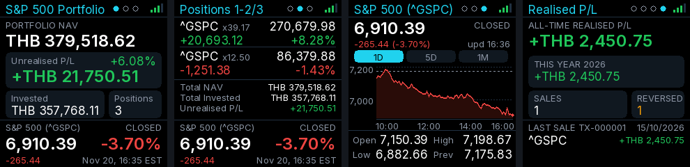
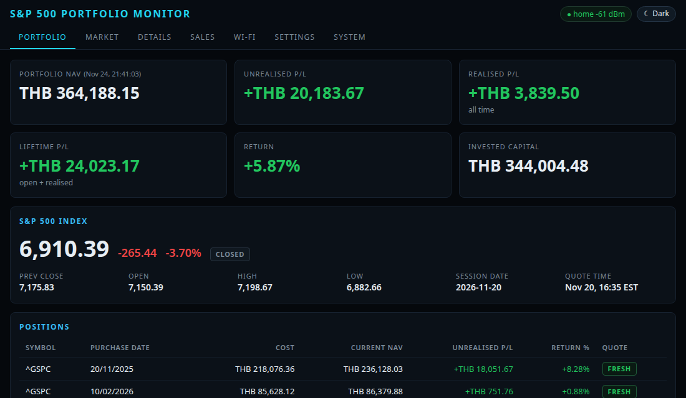
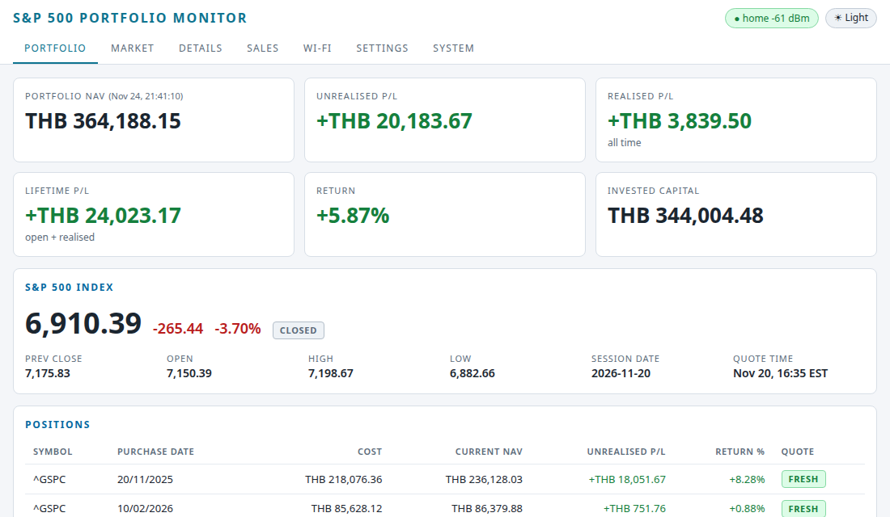
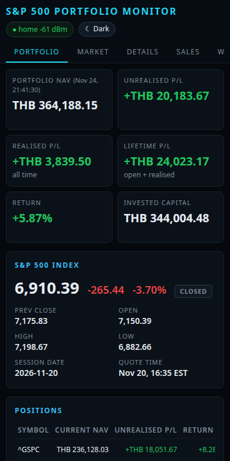

# S&P 500 Portfolio Monitor for GeekMagic SmallTV (ESP8266)

**English** | [ภาษาไทย](README.th.md)

A pocket **S&P 500 / portfolio tracker** for the GeekMagic SmallTV (ESP-12F, 240x240 LCD). It shows your portfolio value and profit/loss on the little screen and serves a full web dashboard (dark and light theme) from the same device. Quotes and charts come from Yahoo Finance; positions and the sale ledger are stored in the device's own flash. No cloud account, no server.



*The four LCD pages that rotate automatically. Rendered on the host with the real firmware font renderer from sample data; the physical panel was not photographed.*

## Screenshots

| Portfolio (dark) | Portfolio (light) |
|---|---|
|  |  |

| Market chart (1D / 5D / 1M) | Sales: sell form and transaction history |
|---|---|
|  |  |

<p align="center"></p>

*Web screenshots are taken against `tools/mock_server.py` with sample data, so numbers are illustrative.*

## Features

* **Portfolio-first LCD:** NAV, unrealised P/L in THB and %, invested capital, per-position rows, a live `^GSPC` ticker, and a separate Realised P/L page (all-time and this year). The web dashboard also shows lifetime P/L. Pages and chart ranges rotate on a timer (the SmallTV has no buttons).
* **Web dashboard** at `http://sp500.local`: portfolio, interactive 1D / 5D / 1M chart with an optional **Bollinger Bands** overlay (SMA 10/20/50, 1.5-2.5 sigma, kept per browser) and, on 1M, **daily candlesticks** (fw 1.2.3, also kept per browser), sortable position table, add and delete positions, Wi-Fi setup, settings, diagnostics, firmware upload. Dark / light theme that follows your OS.
* **Sale ledger:** sell with FIFO (oldest purchase date first) or a specific lot, preview before committing, undo (a reversal record, booked to the sale's own year), delete a transaction, CSV export (every lot each record touched). Append-only with power-loss recovery.
* **Honest numbers:** unknown data is `N/A`, never `0`; a failed refresh keeps the last value and marks it STALE; market status follows the NYSE calendar and New York DST.
* **Self-contained setup:** first boot opens a setup access point with a captive portal; a WPA2 rescue AP appears if the saved network is lost for 3 minutes.
* **OTA updates** from the web page or `pio run -t upload --upload-port <ip>`.

## How it works

```
Yahoo Finance -> MarketData (scheduler) -> AppState (raw inputs)
                                              |
                              FinancialCalculator (the only place money is computed)
                                              |
                      derived outputs: summary / results / quote / chart stats
                            |                                  |
                       SmallTV LCD                     Web API + dashboard
```

Ported from `sp500.ino` (ESP32/TFT_eSPI): same position model (`symbol, qty, buy, date`), same `/portfolio.json` format, same Yahoo `v8/finance/chart` source, same "buy date + THB amount -> buy price = that day's close, qty = THB / price" input convention. Wi-Fi/AP/OTA patterns come from `esp8266_macui.ino`; the display driver and Inter font renderer are copied from it (`src/display/font/`).

## Status - read this first

Firmware **v1.2.9** (on the device since 2026-11-26 03:50, OTA). Hardware-verified items are marked below; everything else is host-tested only.


| Area | State |
|---|---|
| Firmware builds, flashes, boots | **Verified on a real device** (USB serial, currently COM6) |
| Wi-Fi join, mDNS, NTP | **Verified on device** (joined, `sp500.local` announced) |
| Live Yahoo ^GSPC quote + 1D/5D/1M charts, TLS, memory | **Verified on device** (see *Memory*) |
| Portfolio maths | Host-tested (811 checks) **and** the on-device NAV/P&L matches an independent calculation |
| Sale ledger (sell / undo / delete / history / CSV, realised + lifetime P/L) | Host-tested (146 sale-engine checks). **Verified on device (v1.1.1, again on v1.2.0):** preview, confirm (manual and Yahoo-close price), undo, delete, history and CSV, with no reset. On v1.2.0 a real 10,000 THB sale was checked against an independent calculation (cost basis, realised, lot remainder, `lifetime = unrealised + realised` all exact) and the exported CSV row carried the lot detail. Power-loss recovery of the ledger is **not** exercised on hardware |
| LCD layout | Rendered on the host with the real font renderer (77 frames incl. the realised page, 0 overflow/overlap). **The physical LCD was not photographed** |
| LCD brightness (dim) | Host-tested bounds, API output and persistence (settings round trip). The PWM itself is `analogWrite` on GPIO 5, active-low; **how dim it looks is judged by eye on the panel** |
| Web dashboard | Browser-tested against a mock server (desktop + 390 px mobile) **and** opened from the real device (portfolio, sales, theme toggle, sell flow) |
| Web Bollinger Bands overlay (fw 1.2.1) | Maths host-tested: `bbands()` compared with an independent recomputation over the device's own 1D/5D/1M closes, 9 period/width combinations, worst absolute error 1.6e-8 (index ~7,200 -> ~2e-12 relative), all-null when the period exceeds the points, `sd=0` on a flat series. Code is byte-identical to the ESP32 CYD build. **Served by the real device and audited** (21,383 B gz -> 63,341 B, all BB ids/functions present, no candlestick or LCD code). **Not yet eyeballed by a human in a browser** |
| Bollinger Bands **on the LCD**, candlesticks on every range, TLS root pinning | **Not ported** - see *Memory*: the bands need no RAM but the panel version needs scratch arrays, candles for every range need +1.1-2.6 KB static, and CA pinning ~1.5-2.5 KB of heap at the moment the TLS guard has ~300 B to spare |
| **Incident, fw 1.2.3 → 1.2.4: the dashboard went blank** | The first candle build shipped a dashboard that rendered nothing: the new settings object reused the name `CK`, already a top-level `const` in the position table, so the whole inline script failed to compile. Every API endpoint stayed healthy, the LCD was unaffected, and the build looked fine by gz size and by grep - which is why the failure reached the device. Fixed by renaming the candle settings to `CKS`; **fw 1.2.4 is the working build** (`c68da200…`, live, `fw 1.2.4`, chip `D537E4`, 200→230 checks pass against the served page). `tests/web_ui_check.js` was written to catch exactly this class and now runs inside `run_tests.py` |
| Invested capital, Portfolio NAV **and P/L** shown in whole baht (fw 1.2.5-1.2.7) | **Done on both surfaces.** `THB 600,000` / `THB 569,304` / `-THB 30,696` instead of `THB 600,000.00` / `THB 569,304.01` / `-THB 30,695.99`: on the LCD (Portfolio NAV, Unrealised P/L, Invested; Positions totals; the Realised page's lifetime, this-year and last-sale figures) and on the web (all four summary cards, the positions **TOTAL** row, and the realised ledger headline including its "this year" line). **Per-position table cells keep their cents** (cost, current NAV, P/L) - the table is where stams belong, and the ledger amounts a sale was really booked at are never rounded. Display-only: the API still returns `569304.01`/`-30695.99`, flash/CSV/ledger untouched, rounding half-up (`-30,695.99 -> -30,696`, `570,637.99 -> 570,638`), covered by 20 formatter checks. **One consequence to know:** NAV, invested and P/L are rounded independently, so the three headline numbers can visibly disagree by THB 1 even though the underlying identity holds exactly |
| Add a position by THB amount **confirms the price in a dialog** (fw 1.2.8, dialog in 1.2.9) | **Done on both surfaces, and the round trip was run against the real device.** The old flow posted THB and hoped: the price was picked on the device, the position was already written by the time the row appeared, and a purchase dated on a weekend or holiday silently used the close of some earlier session. Now pressing *Add* only looks the price up, and `/api/positions/job` answers with the close, the quantity, **the date of the session it came from and whether that date was exact** (`priceDate`, `exact`). The dashboard then opens a real modal dialog - symbol and purchase date, amount paid, close price, **the session it was priced from with the weekday** (`Fri 20/11/2026`), quantity, cost basis - and when the date itself had no session an amber strip says so: *"21/11/2026 was not a trading day. The close of the last session before it, Fri 20/11/2026, prices this purchase."* The row is written only by *Confirm and add*, which sends back exactly those numbers (the existing `qty`+`buy` endpoint); *Cancel*, the backdrop and Escape all close it and save nothing. API: `"preview":true` on the THB form asks for the lookup without the write. `pickCloseOnDate` gained an out-parameter naming the bar it chose (2 new checks; **831 -> 833 test_core**). New **`tests/add_flow_check.js`** runs the page's real add-position code in a fake DOM - **20 checks**: a THB press must post `thb`+`preview` and must not write, the dialog must open with the right session and warning, the write must carry the price that was on screen, cancel must write nothing, a failed lookup must not open a dialog. It is run by `run_tests.py` and **against the page the device serves**. The dashboard grew 22,483 -> **23,448 B gz** (limit raised 22,528 -> 25,600 B). **Live on `sp500.local` (fw 1.2.9): preview of 10,000 THB on Sat 21/11/2026 returned `6910.39 / 1.447096 / priceDate 2026-11-20 / exact false` and the row count did not move; the served page passes those 20 flow checks and 255 page checks.** Not yet clicked through by a human in a real browser |
| 1M **candlesticks on the web chart** (fw 1.2.3, rebuilt in 1.2.4) | **Built and verified on the device**, on the cheapest footing that keeps them honest: **daily bars for the 1M range only** (1D intraday and 5D stay line charts), bars stored as **int16 offsets on a 0.25-point grid** - **384 B for the bars** (96 B pool + 288 B staging), not the +2.6 KB the ESP32 CYD pays for three float arrays per range. Host tests: parse of the real 1M fixture (23 bars), pack round-trips exact to 1e-4, out-of-window and NaN rejected as `null`, every served bar's high/low contains its own open/close, a bar Yahoo contradicts is nulled rather than clamped, and when a month runs longer than 24 bars the **newest 24** survive unmerged. **Live audit** (fw 1.2.3, chip `D537E4`): 23 bars with `o/h/l`, **no nulls**, every value exactly on the quarter grid (max quantisation error 0.0000), wicks outside the close extremes (6,882.75-7,758.50 vs closes 6,910.39-7,743.98), 12 up / 11 down bodies; 1D and 5D correctly answer `candles:false`; the bars survive a reboot through the v4 cache (`count 23, nulls 0`); heap under two polling clients plus a forced refresh bottomed at **3,376 B free / 2,144 B block**, under a single client at **1,584 / 672** |
| LCD header clock (fw 1.2.2) | Built and **flashed to the device** (fw 1.2.2, `chip.id D537E4`, book/ledger/CSV byte-identical after OTA, steady heap 21,024/20,000 at 5 % frag). Widths proven by `tests/host_header_width.cpp` on the real font tables; the exact string was produced on the host from the real formatter (`Nov 25, 22:25` matching the wall clock). **The panel itself has not been photographed** - the clock's position/legibility is unconfirmed by eye |
| OTA upload | **Verified on device** (repeated flashes with `pio run -t upload --upload-port <ip>`) |
| Rescue AP, captive portal, router-restart recovery, wrong password, settings persistence across reboot | Implemented, **not yet exercised on hardware** |
| Long-run stability (hours), heap fragmentation trend | **Not tested** (minutes only). The heap is tight: see *Memory* |

## Hardware

GeekMagic SmallTV, ESP-12F (ESP8266, 4 MB flash), ST7789 240x240 (SPI **mode 3**, backlight active-low). Pins (from the reference firmware, `src/display/font/lcd_gfx.cpp`): SCLK 14, MOSI 13, DC 0, RST 2, CS 15, BL 5. **No buttons**, so pages and chart ranges rotate automatically (`pageRotateS`).

## Build and flash

Requirements: PlatformIO (tested 6.2.0, `espressif8266@4.1.0` = Arduino-ESP8266 core 3.1.x). Libraries are fetched automatically:

| Library | Version |
|---|---|
| GFX Library for Arduino (moononournation) | 1.6.8 |
| ESP8266 core: ESP8266WiFi, ESP8266WebServer, ESP8266mDNS, DNSServer, ArduinoOTA, Updater, LittleFS | bundled with core 3.1.x |

```bash
cd SP500_SmallTV
pio run                                        # build
pio run -t upload --upload-port COM6           # flash (USB-serial, CH340; COM3 on the original bench)
python tools/serial_log.py COM6 60 --reset     # watch the boot log
```

`tools/patch_gfx_lib.py` runs automatically before the build. It stubs one unused function in the *build copy* of the GFX library to free 6.9 KB of RAM (ESP8266 keeps non-PROGMEM `const` tables in RAM). Without it the Yahoo TLS handshake leaves ~3.6 KB of heap and the chip resets.

**Arduino IDE** (untested): board *NodeMCU 1.0 (ESP-12E)*, CPU 160 MHz, Flash *4MB (FS:2MB OTA:~1019KB)*. Open `SP500_SmallTV.ino`, install the libraries above, and apply the same RAM saving by hand (delete `Arduino_DataBus::writeYCbCrPixels` from the GFX library). PlatformIO is the supported path.

## First-time setup (no Wi-Fi saved)

1. Power on. The LCD shows a QR code and **`sp500-setup-XXXXXX`** (open AP).
2. Join it from a phone (scan the QR). The captive portal opens the dashboard on the **Wi-Fi** tab (or browse to `http://192.168.4.1`).
3. Press *Scan*, pick your **2.4 GHz** network (ESP8266 cannot use 5 GHz), enter the password, *Connect*. The result is reported; credentials are saved only after a successful join.
4. Reach the dashboard at **`http://sp500.local`** or the IP shown on the System tab.

**Wi-Fi recovery.** If the saved network is unreachable for 3 minutes (router replaced, password changed, router off), the device raises a **WPA2 rescue AP** `sp500-setup-XXXXXX` with a random key shown **only on the LCD** (also inside the QR). Join it, open `http://192.168.4.1`, pick the new network. While the rescue AP is up the admin password is waived (physical presence = authorization). The device keeps retrying the saved network and shuts the AP down once it is back and stable. *Forget saved network* (Wi-Fi tab) returns to the open setup AP.

## Using it

* **LCD pages** (auto-rotating; the header clock shows the wall time, not the page): 1 Portfolio (NAV, unrealised P/L THB and %, invested, positions, S&P ticker; realised and lifetime P/L are not on this page), 2 Positions (2 rows per screen, every row reachable, totals, S&P ticker), 3 Market (price, change, status, 1D -> 5D -> 1M charts, O/H/L/Prev or 1M change), 4 Realised P/L (all-time, this year, sales, reversed, last sale) - page 4 is always in the rotation (it shows 0.00 and "no sales yet" until the first sale). The `^GSPC` ticker stays on pages 1-2.
* **Header clock** (fw 1.2.2+): the old page dots in the header are replaced by a wall clock, `Nov 25, 22:12`, right-aligned next to the Wi-Fi icon. It is slot-cached, so it repaints once a minute and costs 48 bytes static. It always shows the fixed local offset (`localOffsetMin`, default UTC+7 = Bangkok) regardless of *Timezone*, because *Timezone* governs the **market** timestamps (ticker stamp, chart axis) - the panel sits in a room with its own clock. Until NTP answers it reads `no clock` in amber. Titles were shortened (`S&P 500`, `Market`, `Pos 1-2/2`) so the longest title plus the longest clock cannot collide at 240 px; `tests/host_header_width.cpp` proves that over every reachable title (11 cases, 0 failures) using the real font metrics.
* **Choosing LCD pages:** Settings tab -> *LCD pages to show* (1 Portfolio, 2 Positions, 3 Market, 4 Realised P/L). The rotation follows your choice at once, no reboot. At least one page must stay ticked; the Wi-Fi setup screen is always available. *Market page charts* (1D / 5D / 1M) picks which chart ranges page 3 cycles through; it changes only the LCD, the web chart still offers all three.
* **Time zone:** Settings tab -> *Time zone* -> *Zone preset*. `exchange` (default) shows every time - LCD and web - in America/New_York with real EST/EDT rules; `local` shows your own fixed UTC offset instead (`UTC offset (minutes)`, e.g. `420` for Thailand). The preset dropdown fills the offset for you: Bangkok/Thailand (ICT, UTC+7), Singapore/KL/HK/Taipei/Beijing (UTC+8), Tokyo/Seoul (UTC+9), India (IST, UTC+5:30) or UTC. None of those zones observe DST, so a fixed offset is exact. Market status, the OPEN/CLOSED badge and the chart day boundaries always follow New York rules, whichever zone you pick.
* **LCD brightness:** Settings tab -> *LCD brightness (%)*. Drag and release, and the panel dims at once - no Save, no reboot, and the level is kept in flash so it comes back after a reboot or an OTA update. `5..100`, default `90` (the level earlier builds used). GPIO 5 PWM, active-low, slider position squared onto duty, `5 %` is a hard floor so the screen can never be dimmed dark for good.
* **Web** `http://sp500.local`: Portfolio, Market (interactive chart, 1D/5D/1M), Details (sortable table, add/delete positions), **Sales** (realised summary with all-time and this-year totals, sell form with preview/confirm, transaction history with undo and CSV export), Wi-Fi, Settings, System (diagnostics, restart, resets, OTA). The date field takes **dd/mm/yyyy** with a calendar button; the API itself uses ISO `yyyy-mm-dd`.
* **Bollinger Bands on the web chart** (fw 1.2.1): on the Market tab, tick **BB** and pick the SMA period (10/20/50) and the width (1.5 / 2 / 2.5 sigma). Bands are computed **in the browser** from the closes the chart already sends, cached per chart, and remembered in that browser's `localStorage` - the device is never asked, keeps no BB state, and nothing is written to flash or settings, so the overlay costs the device zero RAM and zero traffic. The hover readout gains `BB up / middle / down`. Because the bands stretch the price axis, the scale can widen when you switch them on. The device stores a limited number of points per range (80 for 1D, 112 for 5D, 22 for 1M), so a period longer than the stored points draws nothing: on **1M** (22 points) SMA 20 gives only the last three band points and SMA 50 draws nothing at all - that is the same behaviour as the ESP32 build, not a bug.
* **Adding a position:** symbol, purchase date, THB amount. The device fetches the close on that date (last bar *on or before* it for weekends/holidays; never a later bar) and stores `qty = THB / close`. **Since fw 1.2.8-1.2.9 the price is confirmed in a dialog before anything is saved:** the first press only looks it up, then a modal shows the amount, the close, the session that close came from (weekday and date) and the resulting quantity and cost basis, with an amber warning when the purchase date itself was not a trading day. *Confirm and add* writes exactly those numbers; *Cancel*, clicking outside or Escape closes it and saves nothing. Or enter quantity + buy price directly, which skips the lookup.
* **Selling:** pick the symbol, date, method (FIFO = oldest **purchase date** first, ties broken by lot id, and a legacy lot with no date counts as oldest; or one specific lot) and either a quantity, a THB amount or "entire holding". Without an execution price the device fetches the close on that date. *Preview* shows the exact lots, the cost basis and the realised P/L; only *Confirm and commit* writes. *Undo* appends a reversal - the sale stays in the history, and the position (including a fully sold lot) comes back. *Delete* removes a transaction from the history for good (a sale and its undo go together; an active sale is undone first). Export the CSV first if you want a copy.

## Data rules

* THB (portfolio) and index points (S&P 500) are never mixed or formatted alike.
* Unknown data is `N/A` (`null` in the API), never `0`. NAV/P&L/return are `N/A` unless **every** valid position has a quote. Invalid rows (qty/buy <= 0) are flagged and excluded.
* A failed refresh keeps the last good value and marks it **stale** (3x the refresh interval, or a failed refresh, or loaded from flash). The LCD shows STALE; the API has `stale` flags and timestamps.
* Quote time is converted to America/New_York with real EST/EDT rules (not the device clock/timezone). Market status uses the NYSE calendar (weekends, holidays, 13:00 early closes) and an old closing quote is never labelled OPEN.
* After the market closes and the final close is cached, refreshes slow down (quote >= 15 min, charts >= 60 min) and resume at the next open (`/api/status` -> `data.effQuoteS`).
* **Unrealised P/L** covers the open lots only, **Realised P/L** is the sale ledger, **Lifetime P/L** is the two added together. Each side is `N/A` while it is unknown (`realisedPl` before the ledger is read) - never a made-up `0`. A year bucket with no sales is a real `0`, not `N/A`.
* The ledger (`/sells.jsonl`) is **append-only**: a sale appends one record, an undo appends a reversal that references it, and nothing is ever edited or deleted. A commit is journaled first (`/txn.pending`) so a power cut mid-append is completed at the next boot instead of half-applying. Capped at 2000 records (warning at 1800; the UI then asks for archiving).

## API

See [docs/API.md](docs/API.md). Summary: `GET /api/status|portfolio|positions|market|chart?range=1d|5d|1mo|wifi/status|wifi/scan|settings|positions/job`, `POST /api/settings|positions|positions/delete|refresh|cache/clear|wifi/connect|wifi/reconnect|wifi/forget|system/restart|system/reset-settings|system/factory-reset`, `POST /update` (OTA). Sale endpoints: `GET /api/realised|sales|sales/export|sales/job`, `POST /api/sales/preview|sales/confirm|sales/reverse|sales/delete`. Passwords are write-only. If an admin password is set, every `POST`, `/update` **and every sale endpoint** need HTTP Basic auth (`admin:<password>`).

## OTA

* Web: System tab -> choose `firmware.bin` (`.pio/build/smalltv/firmware.bin`) -> Upload. Streamed straight into the Updater (no RAM copy). Refused while a flash write is in progress or heap is too fragmented; Yahoo requests are aborted first; restart only after the reply is sent.
* IDE/CLI: ArduinoOTA on port 8266 (password = admin password), e.g. `pio run -t upload --upload-port sp500.local`.

**Verified over Wi-Fi on fw 1.2.0 (2026-11-25):** `pio run -t upload --upload-port sp500.local` pushed the 716 KB image in **11 s**, the device rebooted into the new firmware and kept LittleFS, config and the ledger untouched. Two things worth knowing before trying it:

* `nc -z sp500.local 8266` reports *connection refused* even when OTA is fine - ArduinoOTA listens on **UDP** 8266 and opens a fresh TCP port per session after the handshake, so a closed TCP 8266 proves nothing.
* With no admin password set, ArduinoOTA has **no password** and `/api/*` (positions, ledger, CSV, settings, `/api/sales/confirm`) is readable *and writable* by anything on the LAN. Set one on the Settings tab first if that bothers you.
* A failed OTA is not rolled back automatically (`ATOMIC_FS_UPDATE=0`): recovery means a USB flash. Keep the previous `firmware.bin` next to the new one.

* **Candlesticks on the 1M chart** (fw 1.2.3): tick **Candles** beside the BB controls and the 1M chart draws daily bars - wick from low to high, body from open to close, green when the close is at or above the open - in place of the area fill. The checkbox is hidden on 1D and 5D because the device holds no bars for them. Bars combine with the bands, and the hover readout gains `O H L C`. A day for which Yahoo did not report all four values shows as a tick at its close, never an invented range. These bars are **daily**: 1M holds about 24 of them, so one candle is a trading day rather than the 30-minute points the line showed.

## Memory (measured on the device)

| | | measured on the device, fw 1.2.0 -> 1.2.1 (2026-11-25) |
|---|---|---|
| Static RAM | 48.2 KB of 80 KB (60.2%, after the GFX patch; 49,300 B on fw 1.1.6) |
| Free heap just after boot | ~23.2 KB |
| Free heap at idle | ~21.9 KB free, largest block ~21.2 KB, fragmentation 4% |
| During a Yahoo request | the guard needs 4.5 KB free after the handshake and clears it when the device is working alone (3 back-to-back 1D+5D+1M refreshes, no error) |
| Worst heap seen | measured on 1.2.1 with a second HTTP client hammering `GET /api/status` every 0.4 s during a refresh: the **1M chart aborted and went stale** (bottom **2,176 free / 1,192 block / 42 % frag**); a 1D fetch completed but bottomed at **1,952 free / 616 block / 58 % frag**. At a gentler 1 s poll rate: 1.2.0 **2,224 / 1,552**, 1.2.1 **3,152 / 2,280** |
| Guard | request refused below 9 KB largest block and aborted if < 4.5 KB heap remains after the handshake (v1.1.1; was 16 KB / 6 KB, lowered so the 5D/1M charts and the sale-price lookup can run) |
| Measured margin | **no usable margin for more chart data.** A per-point OHLC cache (what candlesticks need; the CYD keeps `chartO/H/L[216]`) costs **2,592 B of static RAM**, while the worst dip measured above is 1,952 B free / 616 B block. Even a 2-byte-per-value encoding (1,296 B) would leave ~650 B free, i.e. the `no buffer to allocate -> writes through NULL (Exception 29)` case the guards describe. Candlesticks therefore stay out; the prerequisite is reclaiming margin (pause dashboard polling while a refresh runs), not adding bars - see `PLAN-cyd-to-smalltv.md` |
| Flash | 713 KB of the 1,044 KB app slot (69.9%), 1,332 KB free in the OTA slot |
| Cost of the add-position price confirm (fw 1.2.8-1.2.9) | **+112 B static** (49,880 -> **49,992 B**, 60.9% -> 61.0%) - the price, quantity and session date of the offer now have to survive between the lookup and the confirm (32 B in `AddJob`) plus the JSON the job reports them in; measured against a build of the unmodified 1.2.7 tree, not a guess. Flash **+1,760 B** (731,091 -> 732,851), of which the dashboard is 965 B gz (22,483 -> 23,448 B, limit raised to 25,600 B) - the confirm **dialog** itself costs the device 704 B of flash and **0 B RAM**, it is pure browser markup/CSS. Live heap after the OTA: 21,552 B free / 16,032 B block |
| Cost of the web BB overlay (fw 1.2.1) | **0 B RAM** - static RAM stayed at 49,316 B; the overlay is browser-side, so the only device cost is the dashboard growing by 1,136 B of flash (gz 21,383 B, embedded limit 22,528 B, 1,145 B of headroom left) |
| Cost of 1M candlesticks (fw 1.2.3) | **+516 B static** (49,364 -> 49,880 B, 60.3% -> 60.9%), flash +2.1 KB, dashboard gz 21,383 -> 22,193 B of the 22,528 B limit (335 B headroom). The bars themselves are only **384 B** (96 B pool for the 24 published bars + 288 B staging for up to 48 raw days) because they are packed `int16` offsets on a 0.25 grid rather than floats; the rest is the parser's three extra JSON passes plus serialization. Only **one** range carries bars (`OHLC_CAP = RANGE_1M`): the CYD's `chartO/H/L[216]` floats would have cost **2,592 B**, and even a 1,536 B two-byte version covering 1D+5D+1M was rejected against the measured dips above. Cache format went **v3 -> v4**, so the first boot after this update starts with an empty chart cache and refetches |

Yahoo's TLS Certificate record is **4,610 bytes**, so the receive buffer is 5 KB (the reference firmware's 4 KB would fail). One request at a time; JSON is parsed as a stream straight from the socket (no body buffer). TLS **certificate validation is off** (`setInsecure`, same as the original sketch): a LAN attacker could feed false quotes. Only the TLS handshake (~1.2-1.5 s) blocks the main loop; the web server and LCD run while the body is read.

## Tests

```bash
python tests/run_tests.py            # host unit tests (needs g++/clang++ or `pip install ziglang`)
python tests/preview/run_preview.py  # renders every LCD page to tests/preview/out/*.png + layout checks (needs Pillow)
python tools/mock_server.py          # serves the web UI at :8080 with fake data (MOCK_SCENARIO=normal|stale|missing|offline|empty)
python tools/gen_web_assets.py       # regenerates web/web_assets.h after editing web/index.html
node tests/bbands_check.js           # web Bollinger Bands maths vs an independent recomputation (needs node)
```

Host tests (977 C++ checks plus two node checks, all run by `tests/run_tests.py`):

* `test_core.cpp` (831) - NY DST boundaries, NYSE holidays/early closes, market status, number formats, per-position and portfolio maths (positive/negative P&L, zero/invalid qty, missing/stale quotes, millis wrap), streaming JSON parser (byte-at-a-time, malformed/truncated), real recorded Yahoo responses (`tests/fixtures`), settings validation and persistence, portfolio add/delete/load (incl. the original v1 file format and lot ids), chart downsampling and axis ticks, view rotation (incl. the realised page), and **1M candles** (fw 1.2.3): parse of the recorded 1M fixture, `ohlcPack`/`ohlcUnpack` round-trips and rejection of NaN/out-of-window values, index alignment after `chartStore` (candles follow their own timestamp when raw bars fall off the front), bars kept when the month is longer than the pool, and refusal to publish a candle whose high/low contradicts its own open/close.
* `test_sales.cpp` (146) - allocation (FIFO across lots **in purchase-date order, including same-date ties and dateless legacy lots**, specific lot, by THB, by quantity, sell-all), the CSV export row builder (status words, empty `refPrice`, and the worst-case 12-allocation row fitting the field without clipping), every validation error, the preview token (stable per state, invalidated by any lot mutation), record round-trip through the line format, apply/undo (absolute quantities, replay is a no-op, sold-out lot re-created), aggregates (count/ring/year buckets/reversals), ledger scan (bad lines, unterminated tail), recovery planning, boot recovery (cold + warm + partial tail) and the lifetime identity `lifetime = unrealised + realised` with `N/A` when either side is unknown.

The web chart's **Bollinger Bands** overlay runs in the browser, so no C++ suite can reach it; `node tests/bbands_check.js` (18,635 checks) lifts `bbands()` out of `web/index.html` verbatim and compares it with an independent two-pass recomputation (population std dev, no running sums) over synthetic series (ramp, noise, flat, a series shorter than the period, one point) for every period/width the UI offers, the recorded Yahoo fixtures, and optionally the device's own chart JSON (`node tests/bbands_check.js ~/sp500-backups/live-*/chart_range_*.json`). Worst relative error seen: **2.2e-12**; a period longer than the stored points must return all-null (the drawing code then skips the bands), a flat series must collapse all three lines onto the value, and `up >= md >= dn` is asserted at every point.

**`node tests/web_ui_check.js`** (131 checks built, 230 with a live device) exists because of a real incident, and is now part of `run_tests.py`. The dashboard is a **single inline script**, so one duplicate top-level declaration is a parse-time `SyntaxError` and the browser runs *nothing*: fw 1.2.3 shipped exactly that (the candle settings object was named `CK`, which the position table already used as its column-key list), and the device served a **blank dashboard** while every `/api/*` endpoint kept answering normally. Nothing that was checked at the time would have caught it - gz size was inside the limit, the marker greps passed, the JSON was fine, the LCD was fine. So this test does the thing that actually fails: it extracts the inline scripts and **parses them the way the browser does** (each separately, then all concatenated, which is the only place a duplicate-declaration error appears), checks every `$('id')` the JS looks up exists in the markup (96 of them, 129 ids served), checks every `/api/...` path the dashboard calls matches a `server.on()` route in `WebServerManager.cpp`, keeps the candle drawing conditioned on the device reporting `candles` + `o/h/l` and on per-bar nulls, and re-runs all of it against the page the **device is actually serving** when given a URL (`node tests/web_ui_check.js http://sp500.local/`). Pointed at the saved 1.2.3 page it reports the original failure: `Identifier 'CK' has already been declared`.

## Known limitations

* Unverified on hardware: Wi-Fi scan/connect from the page, rescue AP, settings persistence, reboot-offline cache, long-term heap behaviour, the ledger's power-loss recovery, and the look of the physical LCD (pages are host-rendered).
* Memory is tight: the free heap is ~21 KB at idle and fragments, so a Yahoo request is allowed with a 9 KB largest block. If a chart or the sale-price lookup fails with `low memory`, enter the sale price by hand and retry later. **Opening the web dashboard while a refresh is in flight is what actually causes this**: one browser tab polling `/api/status` costs enough heap to push the 1M chart request under the 4.5 KB guard (measured: aborted at 4,248 B free). It self-heals - the next refresh usually succeeds, and `N/A`/stale is shown meanwhile.
* The ledger has no rotation yet: at 2000 records (`warn` from 1800) new sales are blocked. Export `sells.csv` and start a fresh ledger to continue.
* ESP8266 is 2.4 GHz only. A bad Wi-Fi password is detected after ~4-20 s.
* Yahoo's unofficial endpoint may rate-limit (HTTP 429/403): the device backs off up to 10 min and shows stale data.
* Up to 12 positions and 8 distinct symbols. Non-US symbols work for quotes/prices, but the market-status label always describes the NYSE.
* No buttons on this hardware, so no manual navigation; ranges and pages rotate on a timer.
* The admin password is sent as HTTP Basic over plain HTTP (LAN only).

## Project layout

```
SP500_SmallTV.ino        setup()/loop(): wiring only
src/core/                AppTypes, AppState, MarketClock (NY time/NYSE), Format, JsonWriter, FlatJson
src/finance/             FinancialCalculator, Portfolio (lots + meta), SaleEngine (pure sale maths, host-tested), YahooParser, YahooFinance (transport), MarketData (scheduler), ChartData
src/config/              AppConfig (settings limits/validation)
src/storage/             StorageManager (LittleFS, atomic writes, CRC'd cache), SaleStore (append-only ledger, journal, boot recovery, history, CSV)
src/network/             WiFiManager, WebServerManager (incl. the sale endpoints), OTAManager
src/display/             DisplayManager, UiKit, Widgets, Portfolio/Positions/Market/Realised screens, ChartRenderer, ViewSchedule, font/ (reference driver + fonts)
web/                     index.html (source), web_assets.h (generated, gzip)
tests/ tools/ docs/
```
