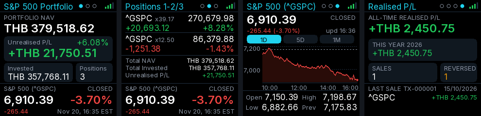
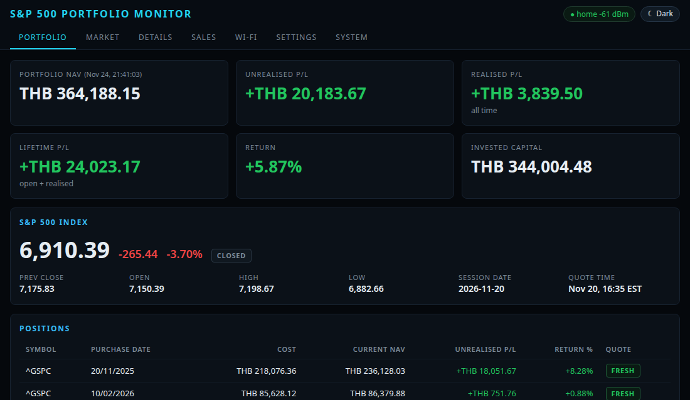
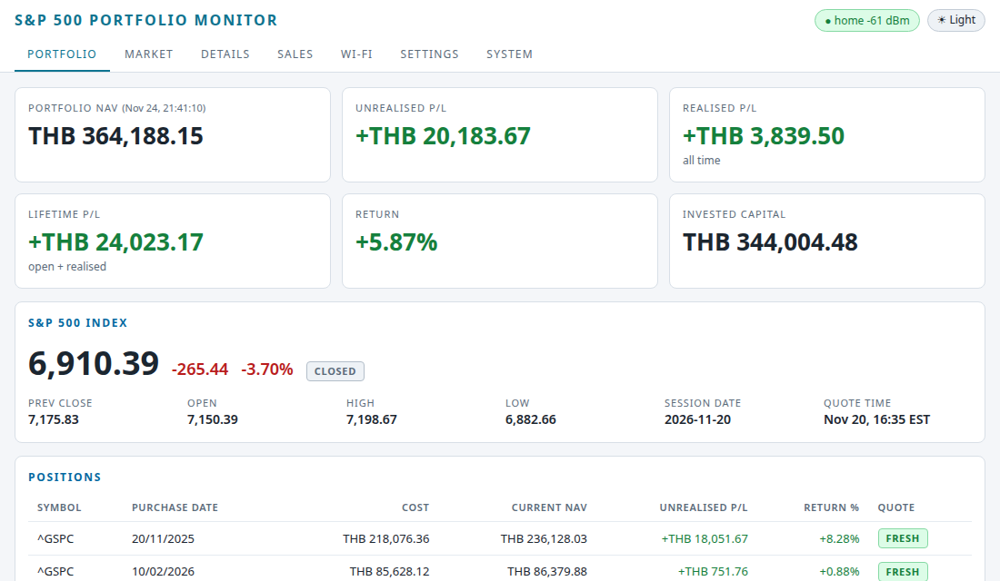
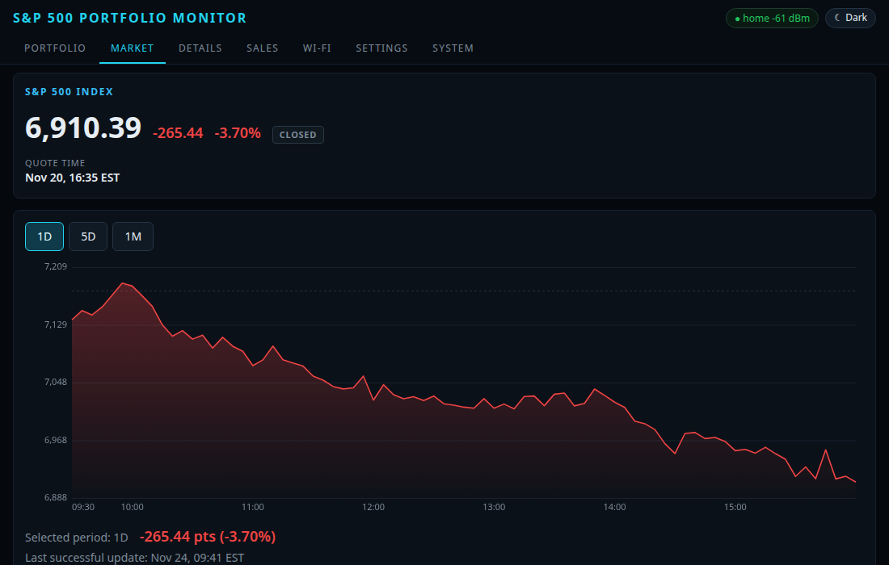
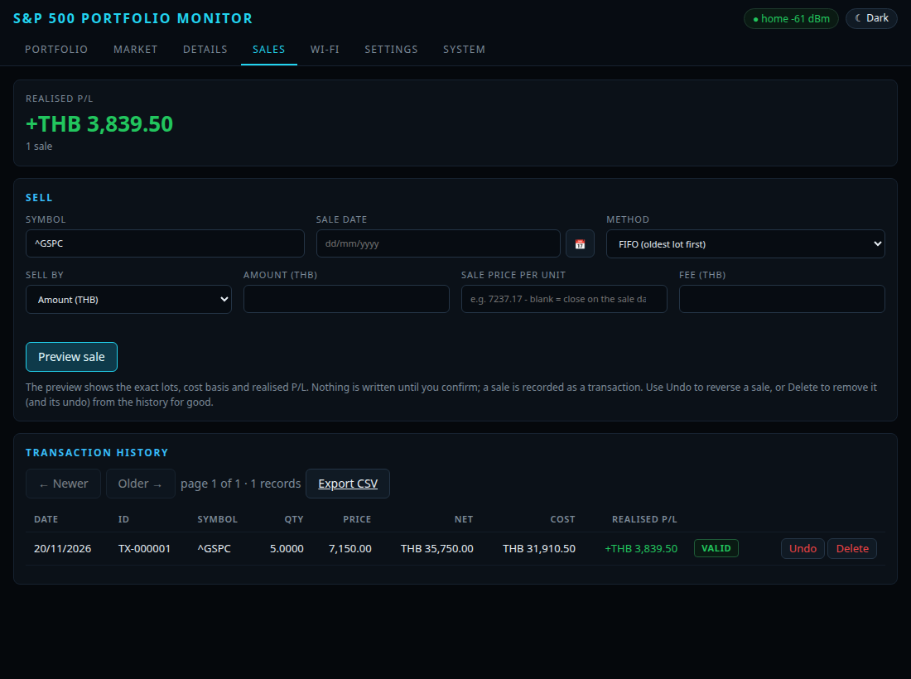
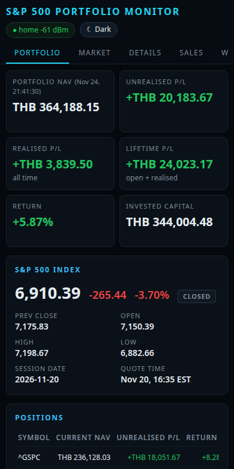

# S&P 500 Portfolio Monitor สำหรับ GeekMagic SmallTV (ESP8266)

[English](README.md) | **ภาษาไทย**

เครื่องติดตาม **ดัชนี S&P 500 และพอร์ตการลงทุน** ขนาดพกพาสำหรับ GeekMagic SmallTV (ESP-12F, จอ LCD 240x240) แสดงมูลค่าพอร์ตและกำไร/ขาดทุนบนหน้าจอเล็กๆ พร้อมเว็บแดชบอร์ดเต็มรูปแบบ (ธีมมืดและสว่าง) จากตัวเครื่องเดียวกัน ราคาและกราฟมาจาก Yahoo Finance ส่วนสถานะพอร์ตและบัญชีการขายถูกเก็บในแฟลชของตัวเครื่องเอง ไม่ต้องมีบัญชีคลาวด์หรือเซิร์ฟเวอร์



*หน้าจอ LCD ทั้งสี่หน้าที่สลับกันอัตโนมัติ ภาพนี้เรนเดอร์บนคอมพิวเตอร์ด้วยตัวเรนเดอร์ฟอนต์จริงของเฟิร์มแวร์จากข้อมูลตัวอย่าง ไม่ใช่ภาพถ่ายจากจอจริง*

## ภาพหน้าจอ

| พอร์ต (ธีมมืด) | พอร์ต (ธีมสว่าง) |
|---|---|
|  |  |

| กราฟตลาด (1D / 5D / 1M) | การขาย: ฟอร์มขายและประวัติธุรกรรม |
|---|---|
|  |  |

<p align="center"></p>

*ภาพเว็บถ่ายจาก `tools/mock_server.py` ด้วยข้อมูลตัวอย่าง ตัวเลขจึงเป็นเพียงตัวอย่าง*

## คุณสมบัติ

* **LCD แสดงพอร์ตเป็นหลัก:** NAV, กำไร/ขาดทุนที่ยังไม่รับรู้เป็นบาทและ %, เงินลงทุน, แถวรายตำแหน่ง, ราคา `^GSPC` สด และหน้ากำไร/ขาดทุนที่รับรู้แล้วแยกต่างหาก (ตลอดอายุและปีนี้) ส่วนกำไร/ขาดทุนรวมดูได้บนเว็บแดชบอร์ด หน้าจอและช่วงกราฟสลับตามเวลา (SmallTV ไม่มีปุ่ม)
* **เว็บแดชบอร์ด** ที่ `http://sp500.local`: พอร์ต, กราฟโต้ตอบ 1D / 5D / 1M, ตารางตำแหน่งที่เรียงได้, เพิ่มและลบตำแหน่ง, ตั้งค่า Wi-Fi, การตั้งค่า, การวินิจฉัย, อัปโหลดเฟิร์มแวร์ ธีมมืด/สว่างตามระบบปฏิบัติการของคุณ
* **บัญชีการขาย:** ขายแบบ FIFO หรือเลือกล็อต, ดูตัวอย่างก่อนยืนยัน, ยกเลิก (Undo ด้วยรายการกลับรายการ), ลบธุรกรรม, ส่งออก CSV เป็นแบบต่อท้ายอย่างเดียวและกู้คืนได้เมื่อไฟดับ
* **ตัวเลขที่ซื่อสัตย์:** ข้อมูลที่ไม่ทราบแสดงเป็น `N/A` ไม่ใช่ `0`; ถ้ารีเฟรชล้มเหลวจะคงค่าล่าสุดไว้และติดป้าย STALE; สถานะตลาดเป็นไปตามปฏิทิน NYSE และเวลาออมแสงของนิวยอร์ก
* **ตั้งค่าได้ด้วยตัวเอง:** บูตครั้งแรกจะเปิดจุดเข้าถึง (AP) สำหรับตั้งค่าพร้อม captive portal; หาก Wi-Fi ที่บันทึกไว้หายไปนาน 3 นาที จะเปิด AP กู้คืนแบบ WPA2
* **อัปเดตผ่าน OTA** จากหน้าเว็บหรือด้วย `pio run -t upload --upload-port <ip>`

## หลักการทำงาน

```
Yahoo Finance -> MarketData (ตัวจัดตารางเวลา) -> AppState (ข้อมูลดิบ)
                                              |
                              FinancialCalculator (ที่เดียวที่คำนวณเงิน)
                                              |
                      ผลลัพธ์: summary / results / quote / chart stats
                            |                                  |
                       LCD ของ SmallTV                  Web API + แดชบอร์ด
```

พอร์ตมาจาก `sp500.ino` (ESP32/TFT_eSPI): ใช้โมเดลตำแหน่งเดียวกัน (`symbol, qty, buy, date`), รูปแบบไฟล์ `/portfolio.json` เดียวกัน, แหล่งข้อมูล Yahoo `v8/finance/chart` เดียวกัน และวิธีป้อนข้อมูลเดิมคือ "วันที่ซื้อ + จำนวนเงินบาท -> ราคาซื้อ = ราคาปิดของวันนั้น, จำนวนหน่วย = บาท / ราคา" รูปแบบ Wi-Fi/AP/OTA มาจาก `esp8266_macui.ino` ส่วนไดรเวอร์จอและตัวเรนเดอร์ฟอนต์ Inter คัดลอกมาจากไฟล์นั้น (`src/display/font/`)

## สถานะ - อ่านก่อน

เฟิร์มแวร์ **v1.1.2** รายการที่ทดสอบกับอุปกรณ์จริงแล้วมีเครื่องหมายไว้ด้านล่าง ส่วนที่เหลือทดสอบบนคอมพิวเตอร์เท่านั้น

| ส่วน | สถานะ |
|---|---|
| คอมไพล์ แฟลช และบูตเฟิร์มแวร์ | **ยืนยันบนอุปกรณ์จริง** (USB serial) |
| เชื่อม Wi-Fi, mDNS, NTP | **ยืนยันบนอุปกรณ์จริง** (เชื่อมได้, ประกาศ `sp500.local`) |
| ราคา ^GSPC จาก Yahoo + กราฟ 1D/5D/1M, TLS, หน่วยความจำ | **ยืนยันบนอุปกรณ์จริง** (ดูหัวข้อ *หน่วยความจำ*) |
| การคำนวณพอร์ต | ทดสอบบนคอมพิวเตอร์ (729 รายการ) **และ** NAV/กำไรขาดทุนบนอุปกรณ์ตรงกับการคำนวณอิสระ |
| บัญชีการขาย (ขาย / ยกเลิก / ลบ / ประวัติ / CSV, กำไรขาดทุนที่รับรู้แล้วและรวม) | ทดสอบบนคอมพิวเตอร์ (128 รายการ) **ยืนยันบนอุปกรณ์ (v1.1.1):** ดูตัวอย่าง, ยืนยัน (ราคาที่ป้อนเองและราคาปิดจาก Yahoo), ยกเลิก, ลบ, ประวัติ และ CSV โดยเครื่องไม่รีเซ็ต ส่วนการกู้คืนบัญชีเมื่อไฟดับ **ยังไม่ได้ทดสอบบนอุปกรณ์** |
| หน้าตา LCD | เรนเดอร์บนคอมพิวเตอร์ด้วยตัวเรนเดอร์ฟอนต์จริง (68 เฟรมรวมหน้ากำไรขาดทุนที่รับรู้แล้ว ไม่มีข้อความล้น/ทับกัน) **ยังไม่ได้ดูบนจอจริง** |
| เว็บแดชบอร์ด | ทดสอบในเบราว์เซอร์กับเซิร์ฟเวอร์จำลอง (เดสก์ท็อปและมือถือ 390 px) **และ** เปิดจากอุปกรณ์จริง (พอร์ต, การขาย, สลับธีม, ขั้นตอนการขาย) |
| อัปโหลด OTA | **ยืนยันบนอุปกรณ์จริง** (แฟลชซ้ำหลายครั้งด้วย `pio run -t upload --upload-port <ip>`) |
| AP กู้คืน, captive portal, การกู้คืนเมื่อรีสตาร์ทเราเตอร์, รหัสผ่านผิด, การเก็บค่าตั้งหลังรีบูต | เขียนไว้แล้ว **ยังไม่ได้ทดสอบบนอุปกรณ์** |
| ความเสถียรระยะยาว (หลายชั่วโมง), แนวโน้มการแตกกระจายของฮีป | **ยังไม่ได้ทดสอบ** (ทดสอบเพียงไม่กี่นาที) หน่วยความจำค่อนข้างตึง ดูหัวข้อ *หน่วยความจำ* |

## ฮาร์ดแวร์

GeekMagic SmallTV, ESP-12F (ESP8266, แฟลช 4 MB), ST7789 240x240 (SPI **โหมด 3**, ไฟหลังจอ active-low) ขา (จากเฟิร์มแวร์อ้างอิง `src/display/font/lcd_gfx.cpp`): SCLK 14, MOSI 13, DC 0, RST 2, CS 15, BL 5 **ไม่มีปุ่ม** จึงสลับหน้าจอและช่วงกราฟอัตโนมัติ (`pageRotateS`)

## คอมไพล์และแฟลช

ต้องมี PlatformIO (ทดสอบกับ 6.2.0, `espressif8266@4.1.0` = Arduino-ESP8266 core 3.1.x) ไลบรารีจะถูกดาวน์โหลดให้อัตโนมัติ:

| ไลบรารี | เวอร์ชัน |
|---|---|
| GFX Library for Arduino (moononournation) | 1.6.8 |
| ESP8266 core: ESP8266WiFi, ESP8266WebServer, ESP8266mDNS, DNSServer, ArduinoOTA, Updater, LittleFS | มากับ core 3.1.x |

```bash
cd SP500_SmallTV
pio run                                        # คอมไพล์
pio run -t upload --upload-port COM6           # แฟลช (USB-serial, CH340) แก้ COM6 เป็นพอร์ตของคุณ
python tools/serial_log.py COM6 60 --reset     # ดู log ตอนบูต
```

`tools/patch_gfx_lib.py` ทำงานอัตโนมัติก่อนคอมไพล์ โดยตัดฟังก์ชันที่ไม่ได้ใช้หนึ่งตัวใน *สำเนาที่ใช้คอมไพล์* ของไลบรารี GFX เพื่อคืน RAM 6.9 KB (ESP8266 เก็บตาราง `const` ที่ไม่ใช่ PROGMEM ไว้ใน RAM) ถ้าไม่มีขั้นตอนนี้ หลังทำ TLS handshake กับ Yahoo จะเหลือฮีปประมาณ 3.6 KB และชิปจะรีเซ็ต

**Arduino IDE** (ยังไม่ได้ทดสอบ): บอร์ด *NodeMCU 1.0 (ESP-12E)*, CPU 160 MHz, Flash *4MB (FS:2MB OTA:~1019KB)* เปิด `SP500_SmallTV.ino`, ติดตั้งไลบรารีข้างต้น และประหยัด RAM ด้วยมือแบบเดียวกัน (ลบ `Arduino_DataBus::writeYCbCrPixels` ออกจากไลบรารี GFX) วิธีที่รองรับคือ PlatformIO

## ตั้งค่าครั้งแรก (ยังไม่มี Wi-Fi ที่บันทึกไว้)

1. เปิดเครื่อง LCD จะแสดง QR code และ **`sp500-setup-XXXXXX`** (AP แบบเปิด)
2. เชื่อมต่อจากโทรศัพท์ (สแกน QR) captive portal จะเปิดแดชบอร์ดที่แท็บ **Wi-Fi** (หรือเข้า `http://192.168.4.1`)
3. กด *Scan* เลือกเครือข่าย **2.4 GHz** ของคุณ (ESP8266 ใช้ 5 GHz ไม่ได้) ใส่รหัสผ่าน แล้วกด *Connect* ระบบจะรายงานผล และบันทึกรหัสผ่านเฉพาะเมื่อเชื่อมต่อสำเร็จ
4. เข้าแดชบอร์ดที่ **`http://sp500.local`** หรือด้วย IP ที่แสดงในแท็บ System

**การกู้คืน Wi-Fi** ถ้าเครือข่ายที่บันทึกไว้เชื่อมไม่ได้นาน 3 นาที (เปลี่ยนเราเตอร์ เปลี่ยนรหัสผ่าน หรือปิดเราเตอร์) เครื่องจะเปิด **AP กู้คืนแบบ WPA2** ชื่อ `sp500-setup-XXXXXX` พร้อมรหัสสุ่มที่แสดง **เฉพาะบน LCD** (และอยู่ใน QR ด้วย) เชื่อมต่อ เปิด `http://192.168.4.1` แล้วเลือกเครือข่ายใหม่ ระหว่างที่ AP กู้คืนเปิดอยู่ จะไม่ต้องใช้รหัสผู้ดูแล (การอยู่ตรงหน้าเครื่องถือเป็นการยืนยันสิทธิ์) เครื่องจะลองต่อเครือข่ายเดิมต่อไป และปิด AP เมื่อกลับมาเชื่อมต่อได้อย่างเสถียร ปุ่ม *Forget saved network* (แท็บ Wi-Fi) จะกลับไปใช้ AP ตั้งค่าแบบเปิด

## วิธีใช้งาน

* **หน้าจอ LCD** (สลับอัตโนมัติ จุดแสดงหน้าปัจจุบัน): 1 พอร์ต (NAV, กำไร/ขาดทุนที่ยังไม่รับรู้เป็นบาทและ %, เงินลงทุน, จำนวนตำแหน่ง, ราคา S&P ส่วนกำไร/ขาดทุนที่รับรู้แล้วและรวมไม่อยู่ในหน้านี้), 2 ตำแหน่ง (หน้าละ 2 แถว เข้าถึงได้ทุกแถว, ยอดรวม, ราคา S&P), 3 ตลาด (ราคา, การเปลี่ยนแปลง, สถานะ, กราฟ 1D -> 5D -> 1M, Open/High/Low/Prev หรือการเปลี่ยนแปลง 1M), 4 กำไร/ขาดทุนที่รับรู้แล้ว (ตลอดอายุ, ปีนี้, จำนวนการขาย, ที่กลับรายการ, การขายล่าสุด) หน้า 4 อยู่ในลำดับหมุนเสมอ (แสดง 0.00 และ "no sales yet" จนกว่าจะมีการขายครั้งแรก) ราคา `^GSPC` แสดงอยู่ที่หน้า 1-2
* **เลือกหน้าที่แสดงบน LCD:** แท็บ Settings -> *LCD pages to show* (1 Portfolio, 2 Positions, 3 Market, 4 Realised P/L) การสลับหน้าและจุดบอกหน้าที่หัวจอจะเปลี่ยนตามทันทีโดยไม่ต้องรีบูต ต้องเลือกอย่างน้อยหนึ่งหน้า และหน้าตั้งค่า Wi-Fi จะใช้งานได้เสมอ ส่วน *Market page charts* (1D / 5D / 1M) เลือกช่วงกราฟที่หน้า 3 จะหมุนแสดง มีผลเฉพาะบน LCD ส่วนกราฟบนเว็บยังเลือกได้ทั้งสามช่วง
* **เว็บ** `http://sp500.local`: Portfolio, Market (กราฟโต้ตอบ 1D/5D/1M), Details (ตารางเรียงได้, เพิ่ม/ลบตำแหน่ง), **Sales** (สรุปกำไรขาดทุนที่รับรู้แล้วทั้งตลอดอายุและปีนี้, ฟอร์มขายแบบดูตัวอย่าง/ยืนยัน, ประวัติธุรกรรมพร้อม Undo และส่งออก CSV), Wi-Fi, Settings, System (การวินิจฉัย, รีสตาร์ท, รีเซ็ต, OTA) ช่องวันที่ใช้รูปแบบ **dd/mm/yyyy** พร้อมปุ่มปฏิทิน ส่วน API ใช้รูปแบบ ISO `yyyy-mm-dd`
* **เพิ่มตำแหน่ง:** สัญลักษณ์, วันที่ซื้อ, จำนวนเงินบาท เครื่องจะดึงราคาปิดของวันนั้น (ใช้แท่งล่าสุด *ในวันนั้นหรือก่อนหน้า* กรณีวันหยุด ไม่ใช้แท่งหลังวันนั้นเด็ดขาด) แล้วเก็บ `qty = บาท / ราคาปิด` หรือจะป้อนจำนวนหน่วยและราคาซื้อเองก็ได้
* **การขาย:** เลือกสัญลักษณ์, วันที่, วิธี (FIFO ล็อตเก่าก่อน หรือเลือกหนึ่งล็อต) และระบุจำนวนหน่วย จำนวนเงินบาท หรือ "ขายทั้งหมด" ถ้าไม่ใส่ราคาขาย เครื่องจะดึงราคาปิดของวันนั้นให้ *Preview* แสดงล็อตที่ใช้จริง ต้นทุน และกำไร/ขาดทุนที่รับรู้ และจะบันทึกก็ต่อเมื่อกด *Confirm and commit* เท่านั้น *Undo* จะเพิ่มรายการกลับรายการ รายการขายยังอยู่ในประวัติ และตำแหน่ง (รวมถึงล็อตที่ขายหมด) จะกลับมา *Delete* ลบธุรกรรมออกจากประวัติถาวร (รายการขายกับรายการ Undo ถูกลบพร้อมกัน ถ้ารายการขายยังใช้งานอยู่ จะถูก Undo ก่อน) ควรส่งออก CSV ก่อนหากต้องการเก็บสำเนา

## กฎของข้อมูล

* บาท (พอร์ต) และจุดดัชนี (S&P 500) จะไม่ถูกนำมาปนหรือจัดรูปแบบเหมือนกัน
* ข้อมูลที่ไม่ทราบคือ `N/A` (`null` ใน API) ไม่ใช่ `0` NAV/กำไรขาดทุน/ผลตอบแทนจะเป็น `N/A` จนกว่า **ทุก** ตำแหน่งที่ถูกต้องจะมีราคา แถวที่ไม่ถูกต้อง (qty/buy <= 0) จะถูกติดธงและไม่นำมาคำนวณ
* ถ้ารีเฟรชล้มเหลวจะคงค่าล่าสุดไว้และติดป้าย **stale** (เมื่อเกิน 3 เท่าของรอบรีเฟรช, รีเฟรชล้มเหลว หรือโหลดมาจากแฟลช) LCD แสดง STALE และ API มีธง `stale` กับเวลากำกับ
* เวลาของราคาถูกแปลงเป็น America/New_York ด้วยกฎ EST/EDT จริง (ไม่ใช้นาฬิกาหรือเขตเวลาของเครื่อง) สถานะตลาดใช้ปฏิทิน NYSE (วันหยุดสุดสัปดาห์, วันหยุดตลาด, ปิดครึ่งวัน 13:00) และราคาปิดเก่าจะไม่ถูกติดป้าย OPEN
* หลังตลาดปิดและเก็บราคาปิดสุดท้ายแล้ว การรีเฟรชจะช้าลง (ราคา >= 15 นาที, กราฟ >= 60 นาที) และกลับมาเร็วเมื่อตลาดเปิดอีกครั้ง (`/api/status` -> `data.effQuoteS`)
* **กำไร/ขาดทุนที่ยังไม่รับรู้** นับเฉพาะล็อตที่ยังถืออยู่ **กำไร/ขาดทุนที่รับรู้แล้ว** มาจากบัญชีการขาย และ **กำไร/ขาดทุนรวม** คือสองส่วนรวมกัน แต่ละส่วนเป็น `N/A` ขณะที่ยังไม่ทราบค่า ไม่แต่งเป็น `0` ส่วนปีที่ไม่มีการขายคือ `0` จริง ไม่ใช่ `N/A`
* บัญชี (`/sells.jsonl`) เป็นแบบ **ต่อท้ายอย่างเดียว**: การขายเพิ่มหนึ่งรายการ การ Undo เพิ่มรายการกลับรายการที่อ้างถึงรายการนั้น (การ Delete เป็นการลบที่ผู้ใช้สั่งเองโดยชัดเจน) การบันทึกจะจดลงไฟล์บันทึกชั่วคราวก่อน (`/txn.pending`) ถ้าไฟดับกลางคันจะทำให้เสร็จตอนบูตครั้งต่อไป ไม่ใช่เสร็จไปครึ่งเดียว จำกัดที่ 2000 รายการ (เตือนที่ 1800)

## API

ดู [docs/API.md](docs/API.md) สรุป: `GET /api/status|portfolio|positions|market|chart?range=1d|5d|1mo|wifi/status|wifi/scan|settings|positions/job`, `POST /api/settings|positions|positions/delete|refresh|cache/clear|wifi/connect|wifi/reconnect|wifi/forget|system/restart|system/reset-settings|system/factory-reset`, `POST /update` (OTA) เส้นทางของการขาย: `GET /api/realised|sales|sales/export|sales/job`, `POST /api/sales/preview|sales/confirm|sales/reverse|sales/delete` รหัสผ่านเขียนได้อย่างเดียว ถ้าตั้งรหัสผู้ดูแล ทุก `POST`, `/update` **และทุกเส้นทางของการขาย** ต้องใช้ HTTP Basic auth (`admin:<รหัสผ่าน>`)

## OTA

* เว็บ: แท็บ System -> เลือก `firmware.bin` (`.pio/build/smalltv/firmware.bin`) -> Upload ข้อมูลถูกส่งตรงเข้า Updater (ไม่ผ่านบัฟเฟอร์ใน RAM) จะปฏิเสธระหว่างกำลังเขียนแฟลชหรือเมื่อฮีปแตกกระจายเกินไป คำขอ Yahoo จะถูกยกเลิกก่อน และรีสตาร์ทหลังตอบกลับเสร็จเท่านั้น
* IDE/CLI: ArduinoOTA พอร์ต 8266 (รหัสผ่าน = รหัสผู้ดูแล) เช่น `pio run -t upload --upload-port sp500.local`

## หน่วยความจำ (วัดบนอุปกรณ์)

| | |
|---|---|
| RAM แบบคงที่ | 48.7 KB จาก 80 KB (59.4% หลังแพตช์ GFX) |
| ฮีปว่างหลังบูต | ~26.7 KB |
| ระหว่างคำขอ Yahoo | ว่างราว 6 KB, บล็อกใหญ่สุดราว 5.9 KB (ไคลเอนต์ + บัฟเฟอร์ TLS 5 KB + handshake) |
| เกณฑ์ป้องกัน | ปฏิเสธคำขอเมื่อบล็อกใหญ่สุดต่ำกว่า 9 KB และยกเลิกถ้าฮีปเหลือน้อยกว่า 4.5 KB หลัง handshake (v1.1.1; เดิม 16 KB / 6 KB ลดลงเพื่อให้กราฟ 5D/1M และการดึงราคาขายทำงานได้ ตรวจสอบเพียงไม่กี่นาที ยังไม่ทดสอบระยะยาว) |
| แฟลช | 706 KB จากช่องแอป 1,044 KB (69.2%) |

TLS Certificate record ของ Yahoo ยาว **4,610 ไบต์** บัฟเฟอร์รับจึงเป็น 5 KB (4 KB ของเฟิร์มแวร์อ้างอิงจะ handshake ไม่ผ่าน) ส่งคำขอได้ทีละหนึ่งรายการ JSON ถูกแยกวิเคราะห์เป็นสตรีมจากซ็อกเก็ตโดยตรง (ไม่มีบัฟเฟอร์เก็บทั้งก้อน) **การตรวจสอบใบรับรอง TLS ปิดอยู่** (`setInsecure` เหมือนสเก็ตช์ต้นฉบับ): ผู้โจมตีในวง LAN อาจส่งราคาปลอมได้ เฉพาะ TLS handshake (~1.2-1.5 วินาที) เท่านั้นที่บล็อกลูปหลัก เว็บเซิร์ฟเวอร์และ LCD ยังทำงานระหว่างอ่านเนื้อหา

## การทดสอบ

```bash
python tests/run_tests.py            # unit test บนคอมพิวเตอร์ (ต้องมี g++/clang++ หรือ `pip install ziglang`)
python tests/preview/run_preview.py  # เรนเดอร์ทุกหน้า LCD เป็น tests/preview/out/*.png + ตรวจเลย์เอาต์ (ต้องมี Pillow)
python tools/mock_server.py          # เปิดเว็บ UI ที่ :8080 ด้วยข้อมูลจำลอง (MOCK_SCENARIO=normal|stale|missing|offline|empty)
python tools/gen_web_assets.py       # สร้าง web/web_assets.h ใหม่หลังแก้ web/index.html
```

Host test (857 รายการ, สองชุดใน `tests/run_tests.py`):

* `test_core.cpp` (729) - ขอบเขต DST ของนิวยอร์ก, วันหยุด/ปิดครึ่งวันของ NYSE, สถานะตลาด, รูปแบบตัวเลข, การคำนวณรายตำแหน่งและพอร์ต (กำไร/ขาดทุน, qty ศูนย์/ไม่ถูกต้อง, ราคาขาด/เก่า, millis วนรอบ), ตัวแยก JSON แบบสตรีม (ทีละไบต์, ผิดรูป/ถูกตัด), ข้อมูล Yahoo จริงที่บันทึกไว้ (`tests/fixtures`), การตรวจและเก็บค่าตั้ง, เพิ่ม/ลบ/โหลดพอร์ต (รวมไฟล์ v1 เดิมและรหัสล็อต), การลดจุดกราฟและขีดแกน, การสลับหน้าจอ (รวมหน้ากำไรขาดทุนที่รับรู้แล้ว)
* `test_sales.cpp` (128) - การจัดสรร (FIFO ข้ามล็อต, ล็อตที่เลือก, ตามบาท, ตามจำนวนหน่วย, ขายทั้งหมด), ข้อผิดพลาดในการตรวจสอบทุกแบบ, โทเค็นของ Preview (คงที่ตามสถานะ, เป็นโมฆะเมื่อล็อตเปลี่ยน), การแปลงรายการไป-กลับ, apply/undo (จำนวนแบบสัมบูรณ์, ทำซ้ำไม่มีผล, สร้างล็อตที่ขายหมดกลับมา), ยอดรวม (จำนวน/ring/รายปี/กลับรายการ), การสแกนบัญชี (บรรทัดเสีย, ท้ายไฟล์ไม่จบ), แผนการกู้คืน, การกู้คืนตอนบูต (เย็น + อุ่น + ท้ายไฟล์ไม่สมบูรณ์), การลบธุรกรรมและการเรียงเลขลำดับใหม่ และสมการ `lifetime = unrealised + realised` โดยเป็น `N/A` เมื่อฝั่งใดฝั่งหนึ่งไม่ทราบ

## ข้อจำกัดที่ทราบ

* ยังไม่ได้ยืนยันบนอุปกรณ์: การสแกน/เชื่อม Wi-Fi จากหน้าเว็บ, AP กู้คืน, การเก็บค่าตั้ง, แคชหลังรีบูตขณะออฟไลน์, พฤติกรรมฮีประยะยาว, การกู้คืนบัญชีเมื่อไฟดับ และหน้าตาของจอ LCD จริง (หน้าจอเรนเดอร์บนคอมพิวเตอร์)
* หน่วยความจำค่อนข้างตึง: ฮีปว่างราว 21 KB ตอนว่างและแตกกระจายได้ จึงอนุญาตให้ส่งคำขอ Yahoo เมื่อบล็อกใหญ่สุดเพียง 9 KB ถ้ากราฟหรือการดึงราคาขายล้มเหลวด้วย `low memory` ให้ป้อนราคาขายเอง แล้วลองใหม่ภายหลัง
* บัญชียังไม่มีการหมุนไฟล์: เมื่อถึง 2000 รายการ (เตือนตั้งแต่ 1800) จะบล็อกการขายใหม่ ให้ส่งออก `sells.csv` แล้วเริ่มบัญชีใหม่
* ESP8266 ใช้ได้เฉพาะ 2.4 GHz รหัสผ่าน Wi-Fi ผิดจะรู้หลังประมาณ 4-20 วินาที
* endpoint ของ Yahoo ไม่เป็นทางการและอาจจำกัดอัตรา (HTTP 429/403): เครื่องจะถอยออกไปสูงสุด 10 นาทีและแสดงข้อมูลเก่า
* รองรับสูงสุด 12 ตำแหน่ง และ 8 สัญลักษณ์ที่ต่างกัน สัญลักษณ์นอกสหรัฐฯ ใช้ได้กับราคา แต่ป้ายสถานะตลาดจะอธิบายถึง NYSE เสมอ
* ฮาร์ดแวร์นี้ไม่มีปุ่ม จึงเลือกหน้าเองไม่ได้ ช่วงกราฟและหน้าจอสลับตามเวลา
* รหัสผู้ดูแลถูกส่งแบบ HTTP Basic ผ่าน HTTP ธรรมดา (ใช้ใน LAN เท่านั้น)

## โครงสร้างโปรเจกต์

```
SP500_SmallTV.ino        setup()/loop(): เชื่อมต่อส่วนต่างๆ เท่านั้น
src/core/                AppTypes, AppState, MarketClock (เวลานิวยอร์ก/NYSE), Format, JsonWriter, FlatJson
src/finance/             FinancialCalculator, Portfolio (ล็อต + meta), SaleEngine (คำนวณการขายล้วนๆ ทดสอบบนคอมพิวเตอร์), YahooParser, YahooFinance (ส่งข้อมูล), MarketData (ตัวจัดตารางเวลา), ChartData
src/config/              AppConfig (ขีดจำกัดและการตรวจค่าตั้ง)
src/storage/             StorageManager (LittleFS, เขียนแบบอะตอมมิก, แคชมี CRC), SaleStore (บัญชีต่อท้ายอย่างเดียว, ไฟล์บันทึกชั่วคราว, กู้คืนตอนบูต, ประวัติ, CSV)
src/network/             WiFiManager, WebServerManager (รวม endpoint การขาย), OTAManager
src/display/             DisplayManager, UiKit, Widgets, หน้าพอร์ต/ตำแหน่ง/ตลาด/กำไรขาดทุนที่รับรู้แล้ว, ChartRenderer, ViewSchedule, font/ (ไดรเวอร์อ้างอิง + ฟอนต์)
web/                     index.html (ต้นฉบับ), web_assets.h (สร้างอัตโนมัติ, gzip)
tests/ tools/ docs/
```
